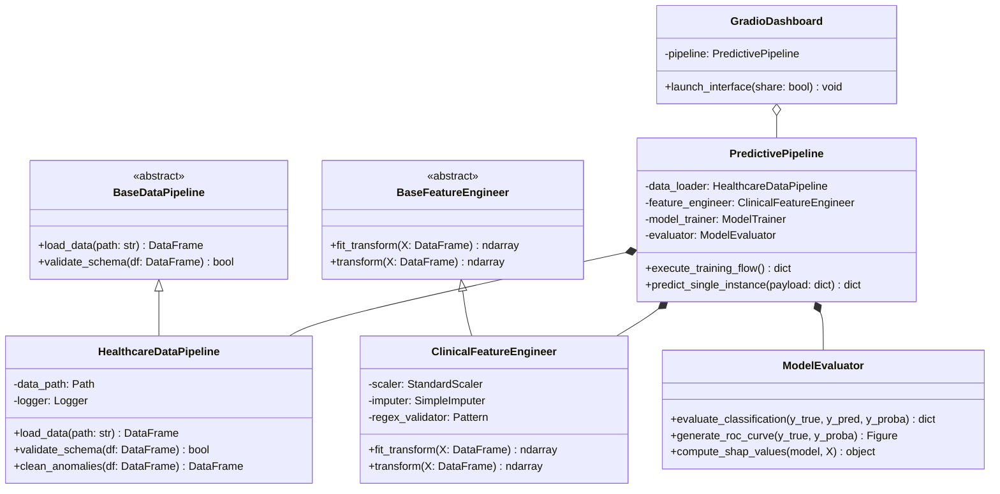
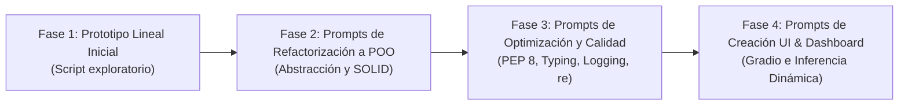
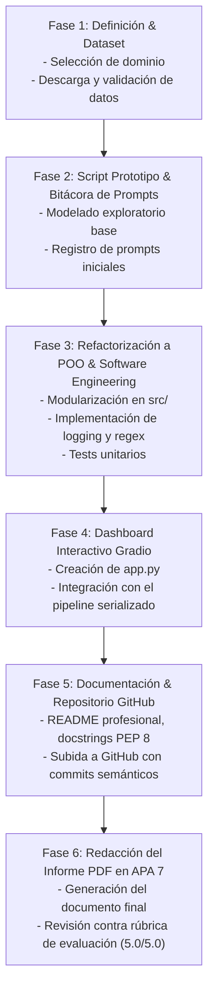

# Plan Maestro de Proyecto: Pipeline de IA con Refactorización POO y Dashboard

**Programa:** Maestría en Ciencia de Datos e Inteligencia Artificial – Universidad de Investigación y Desarrollo (UDI)  
**Curso:** Programación con IA (Actividad Final – 25%)  
**Nivel de formación:** Posgrado / Maestría  
**Entregables requeridos:** 
1. Repositorio funcional en GitHub con código modular, comentado (PEP 8, docstrings, typing), POO y dashboard interactivo.
2. Documento PDF formal (`IICD_apellido_nombre_cedula.pdf`) estructurado según APA 7ma edición con el análisis analítico y metodológico riguroso.

---

## 1. Selección Temática y Dataset Recomendado

Para garantizar un estándar de nivel posgrado que cumpla cabalmente con la rúbrica y aproveche los recursos citados en la guía (UCI ML Repository / Kaggle, Scikit-learn, Gradio, `logging`, `re`), se proponen dos alternativas de alto impacto:

| Opción | Dominio | Dataset Recomendado | Justificación de Posgrado |
| :--- | :--- | :--- | :--- |
| **Opción A (Recomendada)** | **Salud y Biología** | *Heart Disease Clinical Records* (UCI / Kaggle) o *Diabetes Hospital Readmission* | Problema de alta sensibilidad clínica donde la explicabilidad (SHAP), la calibración de probabilidades (Brier Score) y el soporte a decisiones médicas en el dashboard Gradio justifican una arquitectura rigurosa. |
| **Opción B** | **Finanzas y Comercio** | *Credit Risk / Fraud Detection* (Kaggle) | Modelado de desbalance severo de clases, matrices de costo-beneficio financiero y simulación interactiva de aprobación crediticia. |
| **Opción C** | **Impacto Social y Clima** | *Air Quality & Environmental Index* (UCI) | Modelado predictivo ambiental multivariable, análisis de series temporales y visualización geoespacial/interactiva. |

> **Propuesta base para el plan:** **Opción A (Salud y Biología - Predicción de Riesgo Cardiovascular / Insuficiencia Cardíaca)** por su perfecta adaptación a dashboards clínicos y rigor en métricas de sensibilidad/especificidad.

---

## 2. Arquitectura de Software e Ingeniería de IA (Nivel Maestría)

El proyecto trascenderá el típico script o notebook plano hacia una arquitectura de software limpia orientada a objetos (Clean Architecture / SOLID):



### Componentes Clave de Ingeniería de Software:
1. **POO Avanzada:**
   - Separación en módulos: Ingesta, Preprocesamiento, Entrenamiento, Evaluación, Inferencia y UI.
   - Herencia, Clases Abstractas (`abc.ABC`), Tipado estático (`typing`: `Optional`, `Union`, `Dict`, `Tuple`), y Dataclasses para configuración.
2. **Uso de `re` (Expresiones Regulares):**
   - Validación y sanitización estricta de variables de entrada, identificadores clínicos o formatos de entrada en la ingesta y la API del dashboard.
3. **Módulo de Registro Estructurado (`logging`):**
   - Logging profesional configurable (rotación de logs, formatos JSON/legibles, niveles DEBUG, INFO, WARNING, ERROR), eliminando por completo el uso de `print()`.
4. **Validación y Pruebas Unitarias:**
   - Pruebas automatizadas con `pytest` para verificar la transformación de variables y la predicción del pipeline.

---

## 3. Metodología de IA Asistida (Prompt Engineering & Refactorización)

La rúbrica califica con el máximo puntaje: *"Aplica POO (clases/métodos), IA asistida (prompts de refactorización), modelado predictivo adaptado a sus propios datos y dashboards interactivos"*.  
Se estructurará una bitácora científica de **Ingeniería de Prompts en 4 fases**:



En el informe y repositorio se incluirá la **bitácora de prompts**:
- **Prompt:** Contexto, rol, instrucción detallada y restricciones técnicas.
- **Respuesta de la IA (Antigravity / LLM):** Código refactorizado y decisiones arquitecturales.
- **Análisis crítico del estudiante:** Justificación técnica de por qué la versión refactorizada mejora la mantenibilidad, escalabilidad y legibilidad.

---

## 4. Pipeline de Modelado Predictivo y Métricas de Evaluación

Para un trabajo de maestría, el modelado no puede limitarse a un simple `accuracy_score`:
1. **Partición Estratificada y Validación Cruzada:**
   - $k$-Fold Estratificado ($k=5$ o $k=10$) para evitar sesgo de selección y mitigar fugas de datos (*data leakage*).
2. **Benchmark de Modelos Competitivos:**
   - *Baseline*: Regresión Logística regularizada.
   - *Ensemble Trees*: Random Forest Classifier.
   - *Boosting*: HistGradientBoostingClassifier / XGBoost / LightGBM.
3. **Métricas Rigurosas de Negocio/Clínica:**
   - Matriz de Confusión y tasa de Falsos Negativos (riesgo clínico crítico).
   - Sensibilidad (*Recall*), Precisión (*Precision*), y $F_1$-Score ponderado / macro.
   - Curva ROC y Área Bajo la Curva ($AUC\text{-}ROC$).
   - Curva Precision-Recall ($PR\text{-}AUC$) esencial ante desbalance.
   - Brier Score (para calibración probabilística en medicina/finanzas).
4. **Explicabilidad del Modelo (XAI):**
   - Importancia de características mediante permutación o valores SHAP (SHapley Additive exPlanations) integrados al dashboard.

---

## 5. Dashboard Interactivo con Gradio

Desarrollo de un dashboard intuitivo y profesional con **Gradio** (`app.py`):
- **Controles de entrada:** Deslizadores (*sliders*), menús desplegables (*dropdowns*), y campos numéricos con validación regex para cada biomarcador/variable.
- **Salida de predicción en tiempo real:**
  - Diagnóstico categórico (p. ej. "Alto Riesgo" / "Bajo Riesgo").
  - Calibre de probabilidad interactivo (porcentajes de certeza).
  - Interpretación visual de factores de riesgo principales para el paciente evaluado.
- **Pestaña analítica:** Gráficos exploratorios de la población y curvas de rendimiento del modelo.

---

## 6. Estructura del Repositorio de GitHub

El repositorio se estructurará siguiendo los estándares profesionales de la industria de software de IA:

```text
U3-ProgamacionIA/
├── .github/
│   └── workflows/
│       └── ci.yml                 # Integración continua (linter y tests automáticos)
├── data/
│   ├── raw/                       # Dataset original inmutable
│   └── processed/                 # Dataset limpio
├── docs/
│   ├── prompts_log.md             # Bitácora detallada de prompts e IA asistida
│   ├── architecture_diagram.png   # Diagramas de arquitectura y clases UML
│   └── informe_tecnico.pdf        # Copia del informe en PDF
├── logs/                          # Registro de eventos de ejecución (logging)
├── models/                        # Artefactos serializados (.joblib / .pkl)
├── notebooks/
│   └── 01_exploratory_analysis.ipynb # Análisis exploratorio previo a refactorización
├── src/
│   ├── __init__.py
│   ├── config.py                  # Parámetros, rutas y constantes
│   ├── data_ingestion.py          # Clases de ingesta y validación con regex
│   ├── preprocessor.py            # Clases de feature engineering (POO)
│   ├── model_trainer.py           # Clases de entrenamiento, tuning y cross-validation
│   ├── evaluator.py               # Métricas analíticas, ROC, PR y SHAP
│   └── pipeline.py                # Pipeline end-to-end integrador
├── tests/
│   ├── test_ingestion.py          # Pruebas unitarias de carga y validación
│   ├── test_preprocessor.py       # Pruebas de transformación de variables
│   └── test_pipeline.py           # Pruebas de inferencia completa
├── app.py                         # Aplicación interactiva con Gradio
├── requirements.txt               # Dependencias fijadas con versiones
├── setup.py / pyproject.toml      # Configuración del paquete
├── .gitignore                     # Exclusión de venv, caches y datos pesados
└── README.md                      # Documentación completa, badges, guía de instalación y uso
```

---

## 7. Estructura Formal del Informe Académico (PDF bajo Norma APA 7)

El documento final se redactará con lenguaje técnico de maestría y se guardará como `IICD_apellido_nombre_cedula.pdf`:

1. **Portada Institucional:**
   - Título formal del proyecto.
   - Datos del autor (nombre, cédula, maestría, tutor, UDI, año).
2. **Introducción:**
   - Contextualización del problema en el dominio seleccionado.
   - Justificación de la solución mediante Inteligencia Artificial y programación modular.
   - Objetivos del proyecto (técnicos y de ingeniería de software).
3. **Desarrollo del Taller y Metodología:**
   - *3.1 Descripción del conjunto de datos y protocolo de validación*: Características, dimensiones y análisis de variables.
   - *3.2 Ingeniería Asistida por IA y Refactorización a POO*: Presentación de la estrategia de prompts, comparativa antes/después del código, principios de diseño aplicados.
   - *3.3 Arquitectura de Software Orientada a Objetos*: Diagrama UML de clases, modularización, patrones de diseño, robustez (`logging`, `re`, manejo de excepciones).
   - *3.4 Experimentación y Modelado Predictivo*: Benchmarking de modelos, ajuste de hiperparámetros, análisis de curvas ROC, PR, matrices de confusión y explicabilidad.
   - *3.5 Dashboard Interactivo (Gradio)*: Explicación de la interfaz, flujo de inferencia para usuarios no técnicos, capturas de pantalla de casos de prueba.
   - *3.6 Enlace público al Repositorio de GitHub*: Verificación de acceso y reproductibilidad.
4. **Conclusiones y Discusión del Dominio:**
   - Interpretación analítica y crítica de los resultados obtenidos en el dominio.
   - Relevancia e impacto directo en el perfil profesional del Magíster en Ciencia de Datos e IA.
5. **Referencias Bibliográficas:**
   - Formateadas rigurosamente en **APA 7ma edición** (incluyendo scikit-learn, gradio, repositorios de datos y literatura de soporte).

---

## 8. Cronograma de Fases de Ejecución



---

## 9. Criterios de Alineación con la Rúbrica (Evaluación Estratégica: 5.0 / 5.0)

| Criterio de la Rúbrica | Nivel Estratégico Exigido (Máxima Nota) | Implementación en este Plan |
| :--- | :--- | :--- |
| **Organización y presentación (1.0 pt)** | Documento único completo, claro, enlace funcional a GitHub, código con PEP 8, docstrings, typing y lenguaje técnico riguroso. | Repositorio estructurado con linter (flake8/black), docstrings tipo NumPy/Google, README visual y documento PDF en formato institucional APA 7. |
| **Desarrollo de la actividad (3.0 pts)** | Aplica POO (clases/métodos), IA asistida (prompts de refactorización), modelado predictivo adaptado a datos y dashboard interactivo. | Arquitectura de clases modular, bitácora explícita de prompts con análisis crítico, benchmark con validación cruzada y dashboard en Gradio funcional. |
| **Terminología y conclusiones del dominio (1.0 pt)** | Precisión en conceptos de IA y Python, interpretación analítica y crítica de resultados del dashboard, conclusiones sólidas del dominio. | Análisis formal de métricas (no solo accuracy, sino balance de errores, curvas ROC/PR, calibración), discusión del impacto en el dominio y perfil de posgrado. |
