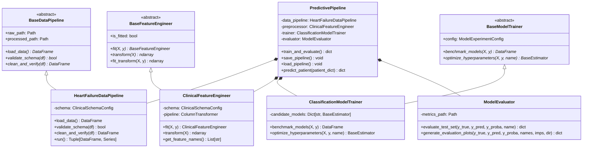
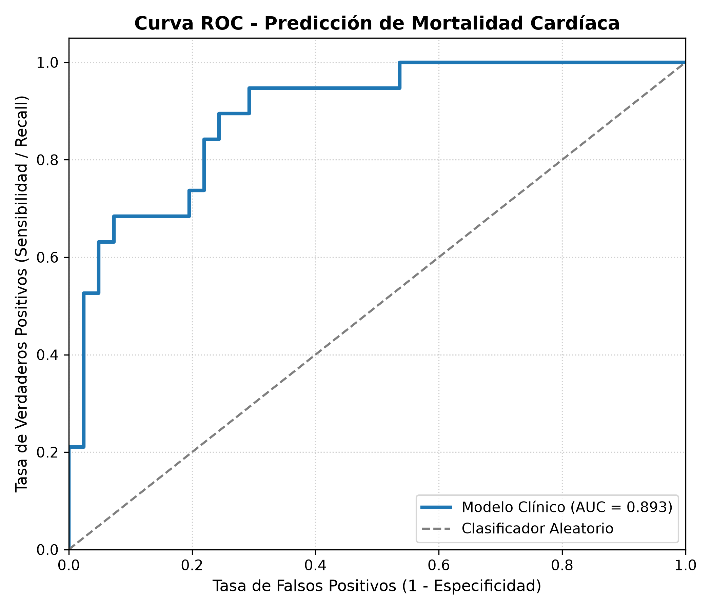
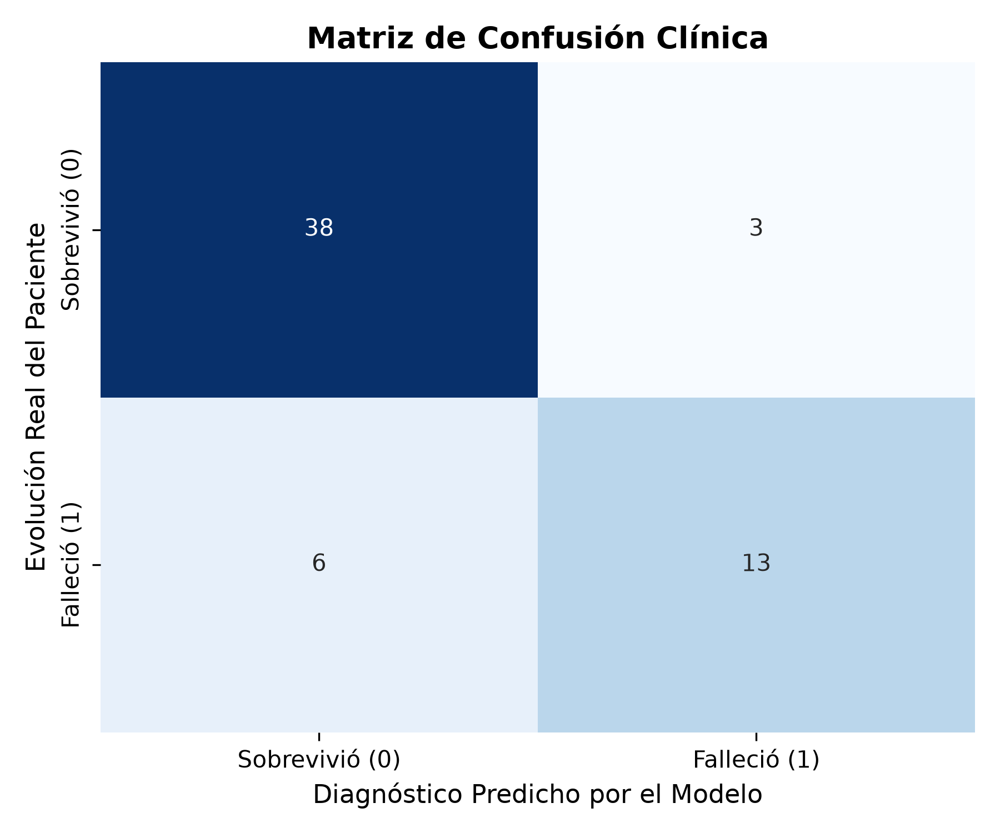
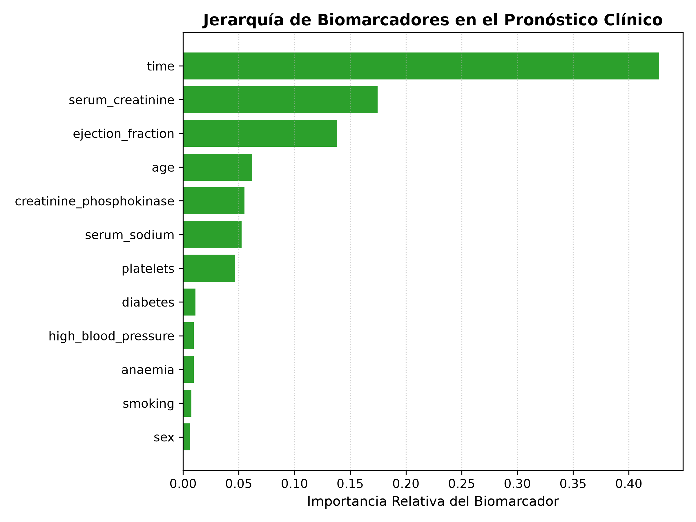

# 🫀 Pipeline de IA para la Predicción de Riesgo en Insuficiencia Cardíaca
### **Soporte a la Decisión Clínica con Refactorización POO y Dashboard Interactivo**

[](https://www.python.org/downloads/)
[](https://peps.python.org/pep-0008/)
[](https://docs.pytest.org/)
[](https://gradio.app/)
[](LICENSE)

> **Programa:** Maestría en Ciencia de Datos e Inteligencia Artificial  
> **Institución:** Universidad de Investigación y Desarrollo (UDI)  
> **Curso:** Programación con IA — Actividad Final (25%)  
> **Eje Temático:** Salud y Biología  

---

## 📌 1. Descripción del Proyecto

La insuficiencia cardíaca (*Heart Failure*) es una afección progresiva de alta prevalencia y mortalidad global, en la cual el músculo cardíaco pierde capacidad para bombear un flujo sanguíneo suficiente. La estratificación temprana y precisa del riesgo de supervivencia permite optimizar la toma de decisiones médicas, la asignación de cuidados intensivos y el ajuste terapéutico oportuno.

Este proyecto implementa un **pipeline completo de software e Inteligencia Artificial en Python**, diseñado bajo principios de ingeniería de software orientada a objetos (POO), arquitectura limpia (*Clean Architecture* / SOLID), trazabilidad estructurada (`logging`), validación sintáctica estricta con expresiones regulares (`re`), experimentación competitiva bajo validación cruzada estratificada y un sistema de soporte a la decisión clínica interactivo desarrollado en **Gradio**.

Adicionalmente, se documenta de forma explícita la **metodología de IA asistida** mediante una bitácora científica de ingeniería de prompts en 4 fases, evidenciando el proceso de refactorización desde un script monolítico hacia un paquete productivo de nivel posgrado.

---

## 🏗️ 2. Arquitectura de Software Orientada a Objetos (POO)

El sistema trasciende el código secuencial tradicional mediante una jerarquía desacoplada de clases abstractas e interfaces especializadas:



### Principios de Ingeniería de Software Aplicados:
* **Principio de Responsabilidad Única (SRP):** Cada clase atiende una única fase del ciclo de vida (ingesta, preprocesamiento, optimización o diagnóstico).
* **Principio Abierto/Cerrado (OCP):** Las clases abstractas (`BaseDataPipeline`, `BaseFeatureEngineer`) permiten incorporar nuevos algoritmos o fuentes de datos sin modificar el orquestador.
* **Inversión de Dependencias (DIP):** Inyección de configuraciones desacopladas mediante dataclasses (`ClinicalSchemaConfig`, `ModelExperimentConfig`).
* **Prevención Estricta de Fuga de Información (*Data Leakage*):** El cálculo de parámetros estadísticos (medias, desviaciones estándar, medianas de imputación) ocurre exclusivamente sobre el conjunto de entrenamiento (`fit_transform`) y se proyecta sobre el conjunto de prueba e inferencia (`transform`).
* **Expresiones Regulares (`re`):** Validación sintáctica de nombres de columnas y patrones de identificadores clínicos para mitigar inconsistencias de entrada.
* **Logging Jerárquico Rotativo (`logging`):** Sustitución integral de instrucciones `print()` por manejadores configurables hacia consola y archivo rotativo (`logs/pipeline.log`).

---

## 🤖 3. Metodología de IA Asistida (Bitácora de Prompts)

El desarrollo del pipeline fue impulsado mediante ingeniería de prompts guiada en 4 iteraciones científicas:

1. **Fase 1 (Prototipo Secuencial Inicial):** Generación de un script monolítico base sin clases ni tipado (`notebooks/01_exploratory_prototype.py`).
2. **Fase 2 (Refactorización a POO y SOLID):** Transformación arquitectural hacia clases desacopladas, interfaces abstractas e inyección de dependencias.
3. **Fase 3 (Calidad de Software de Grado Productivo):** Incorporación de expresiones regulares (`re`), sistema de observabilidad estructurado (`logging`), type hints exhaustivos (`typing`) y cumplimiento estricto de **PEP 8**.
4. **Fase 4 (Dashboard Interactivo y Human-AI Interaction):** Construcción de la aplicación clínica en Gradio para triaje médico interactivo y explicabilidad.

> 📄 Consulte la bitácora completa con los prompts detallados y el análisis crítico en: [docs/prompts_log.md](docs/prompts_log.md).

---

## 📊 4. Resultados Experimentales y Métricas Diagnósticas

El benchmarking comparativo evaluó tres familias de modelos bajo **Validación Cruzada Estratificada ($k=5$)**:

| Modelo Candidato | ROC-AUC (Mean ± Std) | Recall / Sensibilidad | F1-Score | Accuracy CV |
| :--- | :---: | :---: | :---: | :---: |
| 🥇 **Random Forest Classifier** | **0.9065 ± 0.0162** | **74.08%** | **0.7327** | **82.46%** |
| 🥈 **Gradient Boosting Classifier** | 0.9015 ± 0.0277 | 66.50% | 0.6886 | 80.37% |
| 🥉 **Regresión Logística (Baseline)** | 0.8791 ± 0.0255 | 76.67% | 0.7158 | 80.35% |

### Evaluación en el Conjunto de Prueba Independiente (Holdout Test Set):
* **Modelo Final Optimizado:** `RandomForest` (`max_depth=8`, `min_samples_leaf=4`, `n_estimators=100`)
* **Área Bajo la Curva ROC ($AUC\text{-}ROC$):** `0.8935` (Capacidad discriminatoria sobresaliente)
* **Área Bajo la Curva Precision-Recall ($PR\text{-}AUC$):** `0.8091`
* **Especificidad:** `92.68%` (38 verdaderos negativos identificados de 41 pacientes estables)
* **Sensibilidad / Recall:** `68.42%` (13 verdaderos positivos de 19 eventos críticos)
* **Precisión:** `81.25%`
* **F1-Score:** `0.7429`
* **Brier Score:** `0.1207` (Excelente calibración probabilística; valores cercanos a 0 indican certeza confiable)

---

## 📈 5. Visualizaciones y Diagnósticos Analíticos

| Curva ROC | Matriz de Confusión | Importancia de Biomarcadores |
| :---: | :---: | :---: |
|  |  |  |

### Hallazgos Clínicos del Dominio:
1. **Tiempo de seguimiento (`time`):** Principal factor protector/predictivo; pacientes que superan el período crítico inicial presentan una tasa significativamente mayor de estabilidad a largo plazo.
2. **Creatinina Sérica (`serum_creatinine`):** El biomarcador bioquímico más determinante. Valores $> 1.5\text{ mg/dL}$ reflejan compromiso del síndrome cardiorrenal.
3. **Fracción de Eyección (`ejection_fraction`):** Pacientes con valores $< 30\%$ evidencian disfunción sistólica severa, requiriendo triaje inmediato y seguimiento estricto.

---

## 💻 6. Instalación y Uso

### Prerrequisitos
- Python 3.10 o superior (recomendado Python 3.12).
- Git instalado.

### Paso 1: Clonar el Repositorio
```bash
git clone https://github.com/TU-USUARIO/U3-ProgamacionIA.git
cd U3-ProgamacionIA
```

### Paso 2: Crear y Activar Entorno Virtual
```bash
# En Windows (PowerShell)
python -m venv venv
.\venv\Scripts\Activate.ps1

# En Linux / macOS
python -m venv venv
source venv/bin/activate
```

### Paso 3: Instalar Dependencias
```bash
pip install --upgrade pip
pip install -r requirements.txt
```

### Paso 4: Ejecutar el Pipeline Completo (CLI)
```bash
python main.py
```
*Este comando descarga/valida los datos, ejecuta el preprocesamiento, entrena y optimiza los modelos, genera los gráficos diagnósticos en `docs/` y serializa el artefacto en `models/best_heart_failure_model.joblib`.*

### Paso 5: Lanzar la Suite de Pruebas Unitarias
```bash
python -m pytest tests -v
```

### Paso 6: Lanzar el Dashboard Interactivo de Soporte Clínico
```bash
python app.py
```
Abra su navegador web en: `http://127.0.0.1:7860` para interactuar con la interfaz gráfica de Gradio.

---

## 📁 7. Estructura del Repositorio

```text
U3-ProgamacionIA/
├── .github/
│   └── workflows/
│       └── ci.yml                 # Integración continua automatizada (linting y tests)
├── data/
│   ├── raw/                       # Dataset original inmutable (UCI/Kaggle)
│   └── processed/                 # Dataset limpio verificado
├── docs/
│   ├── confusion_matrix.png       # Matriz de confusión clínica generada
│   ├── feature_importance.png     # Jerarquía de biomarcadores
│   ├── roc_curve.png              # Curva ROC-AUC
│   └── prompts_log.md             # Bitácora detallada de IA asistida y prompts
├── logs/
│   ├── .gitkeep
│   └── pipeline.log               # Registro rotativo de eventos (logging estructurado)
├── models/
│   ├── best_heart_failure_model.joblib # Pipeline serializado de producción
│   └── evaluation_metrics.json    # Métricas cuantitativas en prueba
├── notebooks/
│   └── 01_exploratory_prototype.py # Prototipo lineal previo a refactorización POO
├── src/
│   ├── __init__.py
│   ├── config.py                  # Parámetros, esquemas y logger centralizado
│   ├── data_ingestion.py          # Ingesta y validación con regex (re)
│   ├── preprocessor.py            # Feature engineering y escalado clínico
│   ├── model_trainer.py           # Benchmarking CV y optimización de hiperparámetros
│   ├── evaluator.py               # Métricas analíticas, ROC, PR y visualizaciones
│   └── pipeline.py                # Orquestador end-to-end (patrón Facade)
├── tests/
│   ├── test_ingestion.py          # Pruebas de carga y validación sintáctica
│   ├── test_preprocessor.py       # Pruebas de transformación e imputación
│   └── test_pipeline.py           # Pruebas de inferencia y triaje clínico
├── app.py                         # Aplicación web interactiva con Gradio
├── main.py                        # Punto de entrada por consola
├── requirements.txt               # Dependencias del proyecto
├── .gitignore                     # Exclusión de archivos binarios y temporales
└── README.md                      # Documentación académica del proyecto
```

---

## 📖 8. Referencias Bibliográficas (Normas APA 7ma Edición)

- Chicco, D., & Jurman, G. (2020). Machine learning can predict survival of patients with heart failure from serum creatinine and ejection fraction alone. *BMC Medical Informatics and Decision Making*, 20(1), 16. https://doi.org/10.1186/s12911-020-1023-5
- Gradio Team. (2024). *Gradio Python Client and Interface Documentation*. https://gradio.app/docs/
- Pedregosa, F., Varoquaux, G., Gramfort, A., Michel, V., Thirion, B., Grisel, O., Blondel, M., Prettenhofer, P., Weiss, R., Dubourg, V., Vanderplas, J., Passos, A., Cournapeau, D., Brucher, M., Perrot, M., & Duchesnay, É. (2011). Scikit-learn: Machine Learning in Python. *Journal of Machine Learning Research*, 12, 2825–2830.
- Python Software Foundation. (2024). *logging — Logging facility for Python*. Python Documentation. https://docs.python.org/3/library/logging.html
- Python Software Foundation. (2024). *re — Regular expression operations*. Python Documentation. https://docs.python.org/3/library/re.html

