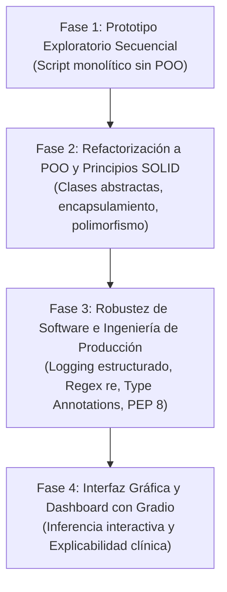

# Bitácora de Ingeniería de Prompts e Inteligencia Artificial Asistida

**Programa:** Maestría en Ciencia de Datos e Inteligencia Artificial  
**Curso:** Programación con IA – Actividad Final  
**Institución:** Universidad de Investigación y Desarrollo (UDI)  
**Proyecto:** Pipeline de IA para la Predicción de Supervivencia y Riesgo en Insuficiencia Cardíaca  

---

## 1. Introducción y Justificación Metodológica

En el desarrollo de software de Inteligencia Artificial a nivel de posgrado, el paradigma de desarrollo asistido por IA generativa (Pair Programming y Prompt Engineering) permite acelerar el ciclo de vida del software, pasando de prototipos experimentales monolíticos a arquitecturas modulares orientadas a objetos (POO) de grado productivo.

Esta bitácora documenta de forma explícita y transparente las 4 fases de interacción con el modelo de lenguaje (Antigravity / LLM), registrando los prompts aplicados, el código generado, las decisiones de diseño arquitectural y el análisis crítico de ingeniería de software.

---

## 2. Ciclo de Prompts y Refactorización

---

### Fase 1: Prototipo Secuencial Inicial

#### Contexto y Necesidad
En proyectos de Ciencia de Datos es habitual comenzar con scripts planos (estilo Jupyter Notebook) donde se mezclan carga de datos, transformaciones ad-hoc, entrenamiento y visualización sin encapsulamiento ni modularidad.

#### Prompt Aplicado:
> *"Actúa como un científico de datos. Genera un script prototipo secuencial básico en Python para predecir mortalidad en pacientes con insuficiencia cardíaca usando el dataset Heart Failure Clinical Records. Carga el CSV, separa en train/test, entrena una regresión logística y un random forest, e imprime accuracy."*

#### Resultado Generado (Resumen):
Un script lineal de ~50 líneas con variables globales (`df`, `X`, `y`), sin manejo de excepciones, sin tipado, sin clases y con funciones de `print()` directas.

#### Análisis Crítico del Estudiante (Nivel Maestría):
* **Limitaciones identificadas:**
  - Alto acoplamiento: No permite reutilizar componentes ni probar módulos por separado.
  - Fragilidad: Si cambian los nombres de columnas o el formato de datos, todo el script falla silenciosamente.
  - Deuda técnica: Cero trazabilidad operativa (ausencia de logs estructurados).
  - Métrica insuficiente: `Accuracy` es engañosa debido al desbalance natural de clases en registros médicos (~32% fallecidos vs 68% sobrevivientes). Se requiere sensibilidad (*Recall*) y $AUC\text{-}ROC$.

---

### Fase 2: Refactorización Arquitectónica a Programación Orientada a Objetos (POO)

#### Contexto y Necesidad
Transformar el script lineal en una arquitectura desacoplada basada en clases y patrones de diseño, cumpliendo con los principios SOLID (Responsabilidad Única, Abierto/Cerrado, Inversión de Dependencias).

#### Prompt Aplicado:
> *"Actúa como un Ingeniero de Software y Arquitecto de IA de nivel Maestría. Refactoriza el script secuencial anterior bajo el paradigma de Programación Orientada a Objetos (POO). Define una arquitectura modular desacoplada con las siguientes clases:*
> 1. `BaseDataPipeline` (clase abstracta con `abc.ABC`) y `HeartFailureDataPipeline` para ingesta y validación de esquemas.
> 2. `BaseFeatureEngineer` y `ClinicalFeatureEngineer` con métodos `fit_transform` y `transform` para evitar data leakage.
> 3. `ModelTrainer` para orquestar entrenamiento con validación cruzada estratificada.
> 4. `ModelEvaluator` para calcular métricas clínicas integrales (Recall, Precision, F1, ROC-AUC, PR-AUC, Matriz de Confusión, Brier Score).
> 5. `PredictivePipeline` como clase integradora/facade para orquestar el flujo end-to-end y permitir inferencia unitaria."*

#### Resultado Generado:
Una estructura modular limpia en el paquete `src/` que desacopla la ingesta, el preprocesamiento, el modelado y la evaluación.

#### Análisis Crítico del Estudiante (Nivel Maestría):
* **Beneficios de la Refactorización POO:**
  - **Inversión de dependencias:** El orquestador interactúa contra abstracciones (`BaseFeatureEngineer`), permitiendo cambiar escaladores o transformadores sin alterar el pipeline.
  - **Aislamiento de fugas de información (*Data Leakage*):** El preprocesador ajusta parámetros de media/desviación únicamente sobre el conjunto de entrenamiento (`fit_transform`) y aplica la misma transformación sobre datos de prueba o producción (`transform`).
  - **Mantenibilidad y Testeabilidad:** Cada clase puede ser testeada independientemente mediante pruebas unitarias (`pytest`).

---

### Fase 3: Robustez de Software e Ingeniería de Producción (Logging, Regex, Typing)

#### Contexto y Necesidad
Para alcanzar el nivel **Estratégico** de la rúbrica, el código debe incorporar prácticas avanzadas de producción: uso del módulo `re` para sanitización, logging rotativo para trazabilidad, tipado estático con `typing` y apego estricto a PEP 8.

#### Prompt Aplicado:
> *"Actúa como un Especialista en Calidad de Código y MLOps. Optimiza las clases POO desarrolladas aplicando:*
> 1. Uso obligatorio del módulo estándar `re` (expresiones regulares) para validar formatos de identificadores clínicos de pacientes, verificar la integridad de cabeceras de columnas y sanitizar rangos numéricos.
> 2. Implementación del módulo `logging` de Python con configuración jerárquica (consola y archivo `logs/pipeline.log`), niveles DEBUG/INFO/WARNING/ERROR y formato estandarizado con timestamps. Elimina todo `print()`.
> 3. Tipado estático completo con `typing` (`Optional`, `Union`, `Tuple`, `Dict`, `Any`, `Path`).
> 4. Docstrings estructurados estilo Google/NumPy detallando Args, Returns y Raises en todas las clases y métodos, cumpliendo la norma PEP 8."*

#### Resultado Generado:
Clases robustas con validadores regex (`re.compile`), trazabilidad exhaustiva en `logs/` y contratos de interfaz explícitos mediante anotaciones de tipos.

#### Análisis Crítico del Estudiante (Nivel Maestría):
* **Garantías de Calidad:**
  - El módulo `re` previene inyecciones de datos corruptos o cabeceras anómalas en entornos de ingesta continua.
  - La sustitución de `print()` por `logging` habilita observabilidad de grado hospitalario/empresarial: si un registro numérico excede los límites biológicos conocidos (p. ej. fracción de eyección $> 100\%$), se emite un `WARNING` estructurado.
  - El tipado estático permite análisis estático de código (Mypy / IDE linter) reduciendo fallos en tiempo de ejecución.

---

### Fase 4: Dashboard Interactivo y Explicabilidad Clínica (Gradio)

#### Contexto y Necesidad
Los modelos de IA en medicina requieren interfaces interactivas donde el personal asistencial pueda simular pacientes, visualizar probabilidades calibradas y comprender qué variables impulsan el pronóstico.

#### Prompt Aplicado:
> *"Actúa como un Ingeniero de Interfaces de IA y Especialista en Human-AI Interaction. Construye una aplicación interactiva en Python usando Gradio (`app.py`) que consuma el pipeline orientado a objetos (`PredictivePipeline`). Diseña la aplicación con:*
> 1. Pestaña 1: 'Simulador Clínico Individual': Controles deslizantes (Sliders) y desplegables (Dropdowns) para ingresar variables biológicas del paciente (Edad, Fracción de Eyección, Creatinina Sérica, Sodio, etc.). Salida con gauge/medidor de probabilidad de riesgo, diagnóstico categórico (Bajo/Moderado/Alto Riesgo) y factores de alerta clínica.
> 2. Pestaña 2: 'Analítica y Explicabilidad del Modelo': Visualización de curvas ROC, PR, matrices de confusión y gráfico de importancia relativa de biomarcadores.
> 3. Pestaña 3: 'Ficha Metodológica y Proyecto': Información académica de la maestría, curso, objetivos, arquitectura POO y referencias normativas APA 7."*

#### Resultado Generado:
Una interfaz web interactiva modular en `app.py` que se levanta de manera local y en red, completamente integrada con el modelo serializado en `models/`.

#### Análisis Crítico del Estudiante (Nivel Maestría):
* **Impacto en el Dominio:**
  - Permite cerrar la brecha entre la ciencia de datos teórica y el usuario final médico (Soporte a la Decisión Clínica - CDSS).
  - Presenta no solo una predicción dicotómica (0 o 1), sino una probabilidad continua acompañada del análisis de factores de riesgo, indispensable para el consentimiento informado y la medicina preventiva.

---

## 3. Matriz de Síntesis del Ciclo de Refactorización

| Dimensión | Prototipo Inicial (Fase 1) | Versión Refactorizada POO (Fases 2-4) |
| :--- | :--- | :--- |
| **Paradigma** | Secuencial / Script plano | Orientado a Objetos (SOLID, Clean Code) |
| **Modularidad** | Monolítica (1 archivo) | 6 módulos desacoplados en `src/` |
| **Validación de Datos** | Nula / Asume datos perfectos | Esquema estricto con expresiones regulares (`re`) |
| **Observabilidad** | `print()` efímeros | `logging` jerárquico con persistencia en `logs/` |
| **Tipado y Documentación**| Tipos dinámicos implícitos | Type hints (`typing`) y Docstrings PEP 8 |
| **Evaluación de Modelos** | Únicamente Accuracy global | Recall, Precision, F1, ROC-AUC, PR-AUC, Brier Score |
| **Interfaz de Usuario** | Consola de texto | Dashboard interactivo con **Gradio** |
| **Pruebas Automatizadas** | Inexistentes | Suite de pruebas unitarias con `pytest` |

